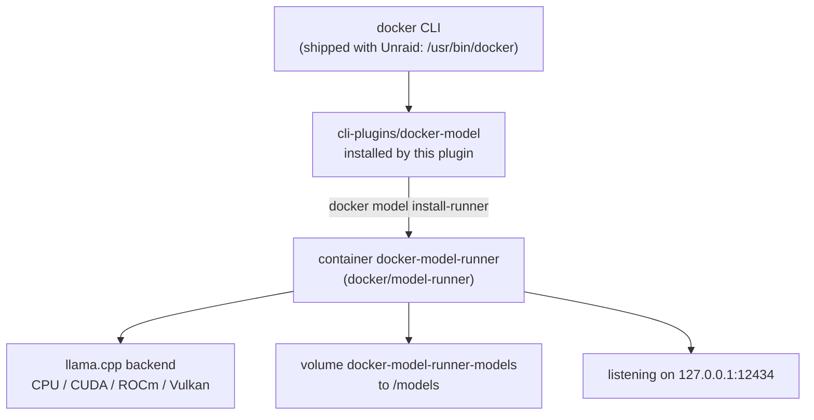
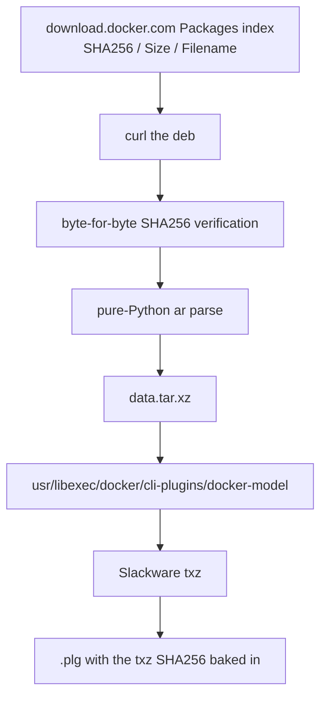

# unraid-plugin-docker-model

**English** | [简体中文](README.zh-CN.md)

[](https://github.com/zhz8888/unraid-plugin-docker-model/actions/workflows/build.yml)
[](LICENSE)
[](https://unraid.net)

**Bring `docker model` (Docker Model Runner) to Unraid OS.**

Unraid does not ship the `docker model` CLI plugin. This project packages it as a
native Unraid plugin (`.plg`) so you can pull and serve AI models locally on your
Unraid server with a single `plugin install`.

---

## The problem

`docker model` is **not** a built-in Docker Engine command. It ships as a separate
CLI plugin package, `docker-model-plugin`, which `docker-ce-cli` merely *suggests*
(not depends on).

Unraid's docker package (`docker-29.x-x86_64-1_LT`, repackaged by Limetech as a
Slackware txz) bundles only two CLI plugins:

```
/usr/libexec/docker/cli-plugins/docker-buildx
/usr/lib/docker/cli-plugins/docker-compose
```

No `docker-model`. Docker itself distributes the plugin only through distro
package managers (apt/yum) and publishes **no binary on GitHub Releases**, so
there is nothing for Unraid's package format to consume directly.

This plugin bridges that gap.

## What it does



The plugin installs the CLI binary into `/usr/libexec/docker/cli-plugins/` and
re-deploys it on every boot (Unraid's `/usr` is an overlay filesystem, so
anything installed there is lost on reboot). The runner container itself is
pulled on demand with `docker model install-runner`.

## Install

### From a release

```bash
# on your Unraid host
cd /boot/config/plugins
wget -O unraid-plugin-docker-model.plg \
  https://github.com/zhz8888/unraid-plugin-docker-model/releases/latest/download/unraid-plugin-docker-model.plg
plugin install /boot/config/plugins/unraid-plugin-docker-model.plg
```

Or install it from **Plugins → Install Plugin** in the Unraid web UI using the
same `.plg` URL.

### Through the gh-proxy.org mirror (mainland China)

If your network cannot reach GitHub, use the mirrored plugin file. The only
difference is the download URL: `https://gh-proxy.org/` is prepended to the
GitHub release URL. The plugin package itself is byte for byte the same file,
with the same SHA256.

```bash
# on your Unraid host
cd /boot/config/plugins
wget -O unraid-plugin-docker-model-proxy.plg \
  https://gh-proxy.org/https://github.com/zhz8888/unraid-plugin-docker-model/releases/latest/download/unraid-plugin-docker-model-proxy.plg
plugin install /boot/config/plugins/unraid-plugin-docker-model-proxy.plg
```

The same prefix works for any GitHub release URL, not just this one:

```
https://gh-proxy.org/https://github.com/<owner>/<repo>/releases/download/<tag>/<file>
```

> **Install one of the two files, not both.**
> The Unraid installer registers one symlink per `.plg` *file name*, so two
> files would show up as two separate entries in the Plugins tab. If both end
> up in `/boot/config/plugins/`, the canonical one removes the mirrored one on
> the next boot — the same way the official Tailscale plugin removes its
> preview build.

Verify:

```bash
docker model version
# Client:
#  Version:    v1.2.9
# Server:
#  Version:    v1.2.9
```

### Then deploy the runner

```bash
# CPU only
docker model install-runner --gpu none

# with an NVIDIA / AMD GPU
docker model install-runner --gpu auto
```

Pull a model and run it:

```bash
docker model pull ai/smollm2:360M-Q4_K_M
docker model run ai/smollm2:360M-Q4_K_M "Hello"
```

### From the WebGUI

The plugin adds a **Settings → Docker Model Runner** page. It reports the
bundled CLI version, the state of the Model Runner and the models that are
available locally, and it can deploy or remove the Model Runner with one
click.

## Build from source

No Go or Rust toolchain is required — this repo never compiles upstream code.

Requirements: Bash 4+, `curl`, `tar`, `xz`, Python 3.

```bash
git clone https://github.com/zhz8888/unraid-plugin-docker-model.git
cd unraid-plugin-docker-model

make build     # download -> verify SHA256 -> unpack -> txz -> plg
make lint      # static checks on the generated .plg
make verify    # hash and layout verification

ls dist/
# unraid-plugin-docker-model-20261105-x86_64-1.txz   <- Slackware package
# unraid-plugin-docker-model.plg                     <- Unraid plugin definition
```

Override the bundled version or architecture:

```bash
DMR_VERSION=1.2.6      make build   # a different upstream release
DMR_ARCH=arm64         make build   # a different architecture
PLUGIN_VERSION=20261105 make build  # pin the plugin version
```

The build is **reproducible**: mtimes are normalised and macOS extended
attributes are stripped before packing, so the same plugin version and
upstream version produce the same txz SHA256 on any machine and from any
checkout location. CI enforces this by building twice and comparing hashes.

### Version scheme

Two versions are tracked independently:

| Version | Format | Meaning |
|---|---|---|
| Plugin version | `YYYYMMDD` | This plugin's own release version: the release date. |
| Upstream version | `1.2.9` | The bundled `docker-model-plugin` release. Recorded in the changelog, the package description and the WebGUI page. |

When more than one release happens on the same day, the later ones carry a
letter suffix:

```
20261105      the first release of that day
20261105.a    the second release of that day
20261105.b    the third release of that day
20261106      the next day
```

The Unraid installer compares plugin versions with `strcmp()`, a byte-wise
string compare, so the format has to sort in release order. This one does
(`20261105 < 20261105.a < 20261105.b < 20261106`); a semantic version such as
`1.2.10` does not, because it sorts *below* `1.2.9` and Unraid would refuse
the upgrade.

The plugin version is deliberately **not** tied to the upstream version: a
repackaging of the same upstream release — a fixed install script, a new WebGUI
page — still has to reach the users who installed an earlier package.

## How the binary is sourced

This project redistributes the `docker-model` binary **unmodified** from Docker's
official apt artifact.



Why the apt artifact rather than a source build? See
[`docs/01-design-decisions.md`](docs/01-design-decisions.md) for the full
evaluation. The short version:

| | apt artifact | source build |
|---|---|---|
| Official binary to compare against | yes (apt metadata) | **none** (no GitHub release assets) |
| Version string correct | `v1.2.9` | degrades to `dev` without manual `-ldflags` |
| Build time | ~2 s | ~2 min (860 MB of Go deps) |
| Supply chain | apt `InRelease` GPG + `Packages` SHA256 | 394 `go.sum` entries |
| Customisable | no | yes |

The binary is statically linked (`CGO_ENABLED=0`, `-trimpath`), so the Ubuntu
package runs unmodified on Slackware-based Unraid.

## Compatibility

| | Requirement |
|---|---|
| Unraid | 7.0+ (needs `/usr/libexec/docker/cli-plugins/`) |
| Architecture | x86_64 (Unraid is x86_64-only; arm64/armhf packages are also built) |
| Docker | 20.10+ (CLI plugin mechanism) |
| Memory | 8 GB+ free recommended for a 1.5B Q4 model |
| GPU | Optional — works CPU-only with `--gpu none` |

## Known limitations

1. **Nothing installed under `/usr` survives a reboot.** Unraid mounts `/usr`
   as a read-only squashfs with a RAM overlay, and `/var/log` — where the
   plugin manager keeps the "installed" registry — is a tmpfs. Every boot
   therefore re-runs the plugin's install script, which restores the binary
   from the copy cached on the flash device. This is also why the install
   script must be idempotent and must never exit non-zero: a non-zero exit
   makes the installer move the `.plg` to `/boot/config/plugins-error/`, which
   leaves the plugin unregistered and without an Uninstall button.
2. **`/root/.docker` is a symlink to `/boot/config/plugins/dockerMan` (vfat).**
   A plugin placed in `~/.docker/cli-plugins/` loses its execute bit and shadows
   the system directory, causing `permission denied`. Use
   `/usr/libexec/docker/cli-plugins/` only. The install script also removes
   stale copies from the other directories the Docker CLI searches, because
   the first match wins.
3. **`docker model pull` ignores the `registry-mirrors` in `daemon.json`.**
   The runner resolves registries directly. On restricted networks use a fully
   qualified name with a proxy prefix, e.g.
   `docker model pull gh-proxy.org/docker/ai/smollm2:360M-Q4_K_M`.
4. **The runner API is unauthenticated.** It binds to `127.0.0.1` and the docker
   bridge gateway by default. Do not expose port `12434` to untrusted networks.

## Conformance with the official Unraid plugin rules

The plugin follows the conventions of the plugins Lime Technology maintains
(`unraid/unraid-tailscale`, `unraid/apprise-plugin`,
`unraid/unraid-nvidia-driver`):

- date based plugin version, because the installer compares plugin versions
  with `strcmp()`;
- a Slackware package installed with `upgradepkg` and removed with `removepkg`;
- the WebGUI page under `/usr/local/emhttp/plugins/<name>/`, with the `launch`
  and `icon` attributes pointing at it;
- `<SHA256>` on every downloaded file, and a version in the cached file name;
- an idempotent install script that never exits non-zero.

[`docs/05-unraid-plugin-conventions.md`](docs/05-unraid-plugin-conventions.md)
maps every rule to the code that implements it, and lists the points that
still need verification on a real Unraid host.

## Naming conventions

| Where | Name | Note |
|---|---|---|
| Repo | `unraid-plugin-docker-model` | this project |
| Unraid plugin | `unraid-plugin-docker-model` | `<PLUGIN name="...">` |
| `.plg` file | `unraid-plugin-docker-model.plg` | goes in `/boot/config/plugins/` |
| Mirrored `.plg` | `unraid-plugin-docker-model-proxy.plg` | install this one **or** the canonical one, never both |
| Flash cache dir | `/boot/config/plugins/unraid-plugin-docker-model/` | holds the txz |
| Slackware package | `unraid-plugin-docker-model-<plugin-version>-x86_64-1.txz` | installed by `upgradepkg` |
| Installed binary | `/usr/libexec/docker/cli-plugins/docker-model` | **name is fixed** |
| WebGUI page | `/usr/local/emhttp/plugins/unraid-plugin-docker-model/DockerModelRunner.page` | target of the `launch` attribute |
| Runner container | `docker-model-runner` | created by `install-runner` |

The installed binary **must** be called `docker-model`: the docker CLI discovers
plugins by the `docker-<subcommand>` filename convention. Everything else uses the
`unraid-plugin-docker-model` prefix.

## Repository layout

```
.
├── README.md                              # this file
├── README.zh-CN.md                        # Chinese README
├── CHANGELOG.md
├── CONTRIBUTING.md
├── SECURITY.md
├── LICENSE                                # MIT (this project)
├── NOTICE                                 # Apache-2.0 attribution for the bundled binary
├── ca_profile.xml                         # Community Apps repository profile
├── Makefile                               # build / lint / verify convenience targets
├── ca/
│   └── unraid-plugin-docker-model.xml     # Community Apps entry for this plugin
├── docs/
│   ├── README.md                          # docs index
│   ├── 01-design-decisions.md             # apt artifact vs source build
│   ├── 02-technical-design.md             # architecture, install/uninstall flow
│   ├── 03-verification-log.md             # measured evidence
│   ├── 04-roadmap.md                      # milestones and TODOs
│   └── 05-unraid-plugin-conventions.md    # mapping to the official plugin rules
├── plugin/
│   └── unraid-plugin-docker-model.plg.in  # Unraid plugin template
├── src/                                   # Slackware package source tree
│   ├── install/
│   │   ├── slack-desc                     # package description
│   │   └── doinst.sh                      # post-install hook
│   └── usr/local/emhttp/plugins/unraid-plugin-docker-model/
│       ├── DockerModelRunner.page         # WebGUI page (Settings tab)
│       ├── DockerModelRunner-1-Settings.page
│       ├── page.php                       # direct URL entry point
│       ├── README.md                      # plugin description for the Plugins tab
│       ├── settings.json                  # plugin settings
│       ├── diagnostics.json               # support bundle definition
│       ├── unraid-plugin-docker-model.png # icon
│       ├── locales/en_US.json
│       └── include/
│           ├── common.php                 # helpers
│           ├── Pages/{Status,Settings}.php
│           └── data/Action.php            # AJAX action endpoint
├── scripts/
│   ├── build-plugin.sh                    # build: deb -> verify -> unpack -> txz -> plg
│   ├── fetch-plugin.sh                    # download + verify + unpack only (audit)
│   ├── lint-plg.sh                        # static checks on the .plg
│   ├── make-icon.py                       # regenerate the plugin icon
│   └── verify-release.sh                  # verify hashes and layout
└── .github/
    ├── workflows/build.yml                # CI: build, lint, verify, reproducibility
    ├── workflows/upstream-check.yml       # daily upstream version check
    └── ISSUE_TEMPLATE/
```

## Documentation

Deep-dive documents live in [`docs/`](docs/README.md). They are written in
Chinese; the code, scripts and this README are in English.

- [Design decisions](docs/01-design-decisions.md) — why the apt artifact, not a source build
- [Technical design](docs/02-technical-design.md) — plugin mechanics, install/uninstall flow, registry prefix handling
- [Verification log](docs/03-verification-log.md) — measured evidence from a real Unraid host
- [Roadmap](docs/04-roadmap.md) — milestones and open questions
- [Unraid plugin conventions](docs/05-unraid-plugin-conventions.md) — how this plugin maps to the official plugin rules

## Contributing

See [CONTRIBUTING.md](CONTRIBUTING.md). Before opening a PR:

```bash
make build && make lint && make verify
```

Bugs in `docker model` itself belong upstream at
[docker/model-runner](https://github.com/docker/model-runner/issues) — this repo
only packages that binary for Unraid.

## License

- This project's scripts and documentation: **MIT** — see [LICENSE](LICENSE).
- The bundled `docker-model` binary: **Apache-2.0**, © Docker, Inc.,
  redistributed unmodified — see [NOTICE](NOTICE).

The `docker/model-runner` container image is not distributed by this project; it
is pulled by the user at runtime.
