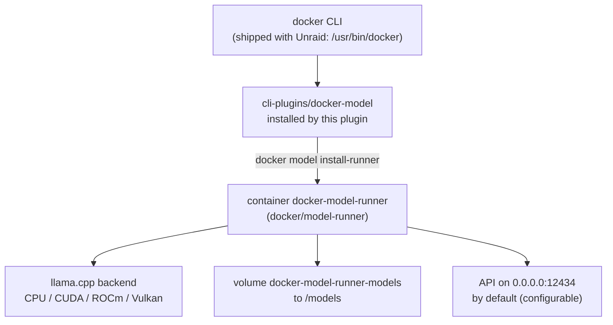
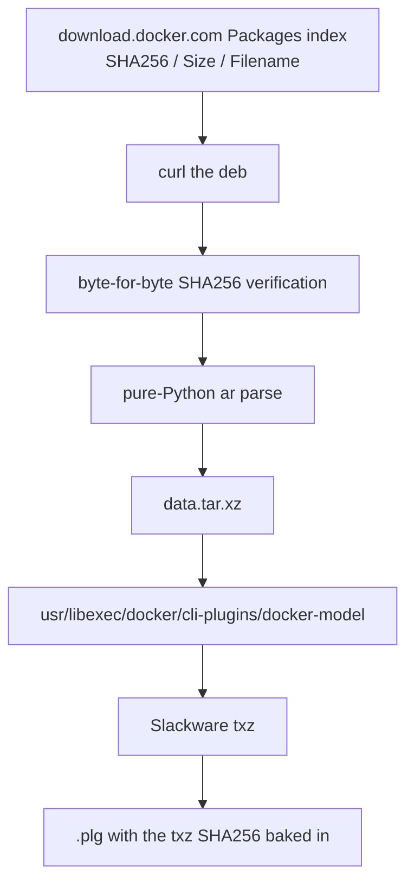

# unraid-plugin-docker-model

**English** | [简体中文](README.zh-CN.md)

[](https://github.com/zhz8888/unraid-plugin-docker-model/actions/workflows/build.yml)
[](LICENSE)
[](https://unraid.net)

**Bring `docker model` (Docker Model Runner) to Unraid OS.**

Unraid does not ship the `docker model` CLI plugin. This project packages it as a
native Unraid plugin (`.plg`) so you can pull and serve AI models locally on your
Unraid server with a single `plugin install`.

---

## The problem

`docker model` is **not** a built-in Docker Engine command. It ships as a separate
CLI plugin package, `docker-model-plugin`, which `docker-ce-cli` merely *suggests*
(not depends on).

Unraid's docker package (`docker-29.x-x86_64-1_LT`, repackaged by Limetech as a
Slackware txz) bundles only two CLI plugins:

```
/usr/libexec/docker/cli-plugins/docker-buildx
/usr/lib/docker/cli-plugins/docker-compose
```

No `docker-model`. Docker itself distributes the plugin only through distro
package managers (apt/yum) and publishes **no binary on GitHub Releases**, so
there is nothing for Unraid's package format to consume directly.

This plugin bridges that gap.

## What it does



The plugin installs the CLI binary into `/usr/libexec/docker/cli-plugins/` and
re-deploys it on every boot (Unraid's `/usr` is an overlay filesystem, so
anything installed there is lost on reboot). The runner container itself is
pulled on demand with `docker model install-runner`. The runner API is
published on every network interface by default, so other devices on your
network can use it; the address is set on the Network card of the page.

## Install

### From a release

```bash
# on your Unraid host
cd /boot/config/plugins
wget -O unraid-plugin-docker-model.plg \
  https://github.com/zhz8888/unraid-plugin-docker-model/releases/latest/download/unraid-plugin-docker-model.plg
plugin install /boot/config/plugins/unraid-plugin-docker-model.plg
```

Or install it from **Plugins → Install Plugin** in the Unraid web UI using the
same `.plg` URL.

### Through the gh-proxy.org mirror (mainland China)

If your network cannot reach GitHub, use the mirrored plugin file. The only
difference is the download URL: `https://gh-proxy.org/` is prepended to the
GitHub release URL. The plugin package itself is byte for byte the same file,
with the same SHA256.

```bash
# on your Unraid host
cd /boot/config/plugins
wget -O unraid-plugin-docker-model-proxy.plg \
  https://gh-proxy.org/https://github.com/zhz8888/unraid-plugin-docker-model/releases/latest/download/unraid-plugin-docker-model-proxy.plg
plugin install /boot/config/plugins/unraid-plugin-docker-model-proxy.plg
```

The same prefix works for any GitHub release URL, not just this one:

```
https://gh-proxy.org/https://github.com/<owner>/<repo>/releases/download/<tag>/<file>
```

> **Install one of the two files, not both.**
> The Unraid installer registers one symlink per `.plg` *file name*, so two
> files would show up as two separate entries in the Plugins tab. If both end
> up in `/boot/config/plugins/`, the canonical one removes the mirrored one on
> the next boot — the same way the official Tailscale plugin removes its
> preview build.

Verify:

```bash
docker model version
# Client:
#  Version:    v1.2.9
# Server:
#  Version:    v1.2.9
```

### Then deploy the runner

```bash
# CPU only
docker model install-runner --gpu none

# with an NVIDIA / AMD GPU
docker model install-runner --gpu auto
```

The CLI publishes the API on `127.0.0.1` and on the docker bridge gateway
unless `--host` is given, so a runner started this way is reachable from the
server only. The WebGUI page passes the stored listen address (default
`0.0.0.0`) to `install-runner`; add `--host 0.0.0.0` yourself if you deploy
from a terminal and want the same.

Pull a model and run it:

```bash
docker model pull ai/smollm2:360M-Q4_K_M
docker model run ai/smollm2:360M-Q4_K_M "Hello"
```

`docker model stop-runner` removes the runner container and keeps the runner
image and the model volume, so the next install starts the existing image
without pulling it again. In the bundled CLI 1.2.9 `uninstall-runner` shares
that cleanup path; only its optional flags also remove the image and the model
volume.

### From the WebGUI

The plugin adds a **Settings → User Utilities → Docker Model Runner** card to
the Settings page, the same way the official Compose Manager plugin does. The
page is a grid of cards, one per function:

- a hero strip with the plugin icon, a short description and three live status
  pills — CLI, Runner and Models — plus a **Refresh** button;
- **Status** — the plugin version, the bundled docker-model version and the
  upstream artifact, plus `docker model version` split into one row per field:
  client version, client platform, server version and server engine. The raw output is kept in a collapsed **Raw output** block
  for troubleshooting and opened automatically when the CLI prints a layout
  the page does not know;
- **Model Runner** — the state of the runner and the buttons that install it
  (CPU only or GPU auto), **Stop** it or remove it. Stop removes the container
  and keeps the runner image and the model volume; every button is enabled only
  in the state it applies to;
- **Network** — the address the runner API is published on, the local client
  API Key (default `local`), the ports the running container is actually
  published on, the settings file, and the **Save** and **Recreate runner** buttons (see
  [Publishing the runner on the network](#publishing-the-runner-on-the-network));
- **Local models** — a table of the models that are available locally, one row
  per tag, with the parameters, quantization, architecture, size and creation
  time. Every row can be updated (pull the same tag again; layers that did not
  change are reused) or removed after a confirmation. Both actions run in the
  background and log to `/var/log/docker-model-runner-model.log`;
- **Installation** — the CLI directory, the CLI binary, the installed binary,
  the equivalent terminal commands (including the stored `--host` address), and
  an OpenAI-compatible Python client example that uses the saved API Key;
- **Notes** — the caveats that come with the runner.

The six cards are equal sized: the grid stretches every card of a row to the
height of the tallest one, so the buttons of a card line up with the buttons of
the cards next to it, and the model list scrolls inside its card. The grid is
one column below 780 px, two columns from 780 px and three columns from
1500 px.

Everything that needs a `docker` call is loaded asynchronously after the page
has been rendered, so a stopped Model Runner never delays the page itself.

The page follows the language of the Unraid WebGUI. The plugin ships its own
translation files in `locales/`, next to the page file: `en_US.json` is the
English base, `zh_CN.json` is the Simplified Chinese translation. A new locale
is added by dropping a `<locale>.json` file with the same keys into that
directory.

### Publishing the runner on the network

The runner API is published on **`0.0.0.0` by default**, so any device on the
network can use it at `http://<NAS-IP>:12434`. This is deliberate:
`docker model` has no `--network` flag, it publishes the container port with
`--host <ip>`, and its own default — `127.0.0.1`, plus the docker bridge
gateway the CLI binds on top of it — is only reachable from the server.

The **Network** card chooses the address:

| Choice | Effect |
|---|---|
| `0.0.0.0` (default) | every interface — reachable from the LAN |
| `127.0.0.1` | the server only |
| a custom IPv4 or IPv6 address | one specific interface |

The address is validated as an IP address on the server before it is stored, and
quoted with `escapeshellarg()` when it is appended to the command line; an
invalid value is refused, not saved. It is the only setting that reaches a
command line. The address and API Key live in
`/boot/config/plugins/unraid-plugin-docker-model/unraid-plugin-docker-model.cfg`
as `DMR_HOST` and `DMR_API_KEY`. The file is written atomically with owner-only
permissions (`0600`), next to the cached package on the flash device, so the
settings survive a reboot and, like the rest of that directory, plugin removal.
A missing `DMR_API_KEY` in an older configuration defaults to `local`.

The **API Key** field is for OpenAI-compatible clients, which require an
`api_key` value even though the local runner does not authenticate requests. It
defaults to `local`, accepts 1–128 letters, digits or `. _ ~ + / = -`, and can be
revealed with **Show**. Saving an empty field restores `local`. The Installation
card's Python example follows the value in this field. The key is never passed
to `docker model` and does not enable authentication.

The address is part of the container definition, so a changed setting takes
effect only on a new container: **Recreate runner** runs the command
`docker model reinstall-runner --gpu <detected> --host <address>` with the
GPU mode read back from the image of the running container (`-cuda`,
`-rocm`, `-musa`, `-cann`, otherwise `none`; `auto` when it cannot be
read), so a CPU-only installation on a GPU host does not silently become a
CUDA one. The port stays `12434` either way, because the CLI connects to that
port on localhost.

The API is unauthenticated. `0.0.0.0` exposes it to every device that can
reach the network: restrict port `12434` with a firewall, or switch the page
back to `127.0.0.1`.

## Build from source

No Go or Rust toolchain is required — this repo never compiles upstream code.

Requirements: Bash 4+, `curl`, `tar`, `xz`, Python 3.

```bash
git clone https://github.com/zhz8888/unraid-plugin-docker-model.git
cd unraid-plugin-docker-model

make build     # download -> verify SHA256 -> unpack -> txz -> plg
make lint      # static checks on the generated .plg
make verify    # hash and layout verification

ls dist/
# unraid-plugin-docker-model-20261105-x86_64-1.txz   <- Slackware package
# unraid-plugin-docker-model.plg                     <- Unraid plugin definition
```

Override the bundled version or architecture:

```bash
DMR_VERSION=1.2.6      make build   # a different upstream release
DMR_ARCH=arm64         make build   # a different architecture
PLUGIN_VERSION=20261105 make build  # pin the plugin version
```

The build is **reproducible**: mtimes are normalised and macOS extended
attributes are stripped before packing, so the same plugin version and
upstream version produce the same txz SHA256 on any machine and from any
checkout location. CI enforces this by building twice and comparing hashes.

### Version scheme

Two versions are tracked independently:

| Version | Format | Meaning |
|---|---|---|
| Plugin version | `YYYYMMDD` | This plugin's own release version: the release date. |
| Upstream version | `1.2.9` | The bundled `docker-model-plugin` release. Recorded in the changelog, the package description and the WebGUI page. |

When more than one release happens on the same day, the later ones carry a
letter suffix:

```
20261105      the first release of that day
20261105.a    the second release of that day
20261105.b    the third release of that day
20261106      the next day
```

The Unraid installer compares plugin versions with `strcmp()`, a byte-wise
string compare, so the format has to sort in release order. This one does
(`20261105 < 20261105.a < 20261105.b < 20261106`); a semantic version such as
`1.2.10` does not, because it sorts *below* `1.2.9` and Unraid would refuse
the upgrade.

The plugin version is deliberately **not** tied to the upstream version: a
repackaging of the same upstream release — a fixed install script, a new WebGUI
page — still has to reach the users who installed an earlier package.

## How the binary is sourced

This project redistributes the `docker-model` binary **unmodified** from Docker's
official apt artifact.



Why the apt artifact rather than a source build? See
[`docs/01-design-decisions.md`](docs/01-design-decisions.md) for the full
evaluation. The short version:

| | apt artifact | source build |
|---|---|---|
| Official binary to compare against | yes (apt metadata) | **none** (no GitHub release assets) |
| Version string correct | `v1.2.9` | degrades to `dev` without manual `-ldflags` |
| Build time | ~2 s | ~2 min (860 MB of Go deps) |
| Supply chain | apt `InRelease` GPG + `Packages` SHA256 | 394 `go.sum` entries |
| Customisable | no | yes |

The binary is statically linked (`CGO_ENABLED=0`, `-trimpath`), so the Ubuntu
package runs unmodified on Slackware-based Unraid.

## Compatibility

| | Requirement |
|---|---|
| Unraid | 7.0+ (needs `/usr/libexec/docker/cli-plugins/`) |
| Architecture | x86_64 (Unraid is x86_64-only; arm64/armhf packages are also built) |
| Docker | 20.10+ (CLI plugin mechanism) |
| Memory | 8 GB+ free recommended for a 1.5B Q4 model |
| GPU | Optional — works CPU-only with `--gpu none` |

## Known limitations

1. **Nothing installed under `/usr` survives a reboot.** Unraid mounts `/usr`
   as a read-only squashfs with a RAM overlay, and `/var/log` — where the
   plugin manager keeps the "installed" registry — is a tmpfs. Every boot
   therefore re-runs the plugin's install script, which restores the binary
   from the copy cached on the flash device. This is also why the install
   script must be idempotent and must never exit non-zero: a non-zero exit
   makes the installer move the `.plg` to `/boot/config/plugins-error/`, which
   leaves the plugin unregistered and without an Uninstall button.
2. **`/root/.docker` is a symlink to `/boot/config/plugins/dockerMan` (vfat).**
   A plugin placed in `~/.docker/cli-plugins/` loses its execute bit and shadows
   the system directory, causing `permission denied`. Use
   `/usr/libexec/docker/cli-plugins/` only. The install script also removes
   stale copies from the other directories the Docker CLI searches, because
   the first match wins.
3. **`docker model pull` ignores the `registry-mirrors` in `daemon.json`.**
   The runner resolves registries directly. On restricted networks use a fully
   qualified name with a proxy prefix, e.g.
   `docker model pull gh-proxy.org/docker/ai/smollm2:360M-Q4_K_M`.
4. **The runner API is unauthenticated.** The page publishes it on `0.0.0.0`
   by default, so every device on the network can use it. Set the address to
   `127.0.0.1` on the page, or restrict port `12434` with a firewall; do not
   expose it to untrusted networks.

## Conformance with the official Unraid plugin rules

The plugin follows the conventions of the plugins Lime Technology maintains
(`unraid/unraid-tailscale`, `unraid/apprise-plugin`,
`unraid/unraid-nvidia-driver`):

- date based plugin version, because the installer compares plugin versions
  with `strcmp()`;
- a Slackware package installed with `upgradepkg` and removed with `removepkg`;
- the WebGUI page under `/usr/local/emhttp/plugins/<name>/`, with the `launch`
  and `icon` attributes pointing at it;
- `<SHA256>` on every downloaded file, and a version in the cached file name;
- an idempotent install script that never exits non-zero.

[`docs/05-unraid-plugin-conventions.md`](docs/05-unraid-plugin-conventions.md)
maps every rule to the code that implements it, and lists the points that
still need verification on a real Unraid host.

## Naming conventions

| Where | Name | Note |
|---|---|---|
| Repo | `unraid-plugin-docker-model` | this project |
| Unraid plugin | `unraid-plugin-docker-model` | `<PLUGIN name="...">` |
| `.plg` file | `unraid-plugin-docker-model.plg` | goes in `/boot/config/plugins/` |
| Mirrored `.plg` | `unraid-plugin-docker-model-proxy.plg` | install this one **or** the canonical one, never both |
| Flash cache dir | `/boot/config/plugins/unraid-plugin-docker-model/` | holds the txz and the settings file `unraid-plugin-docker-model.cfg` |
| Slackware package | `unraid-plugin-docker-model-<plugin-version>-x86_64-1.txz` | installed by `upgradepkg` |
| Installed binary | `/usr/libexec/docker/cli-plugins/docker-model` | **name is fixed** |
| WebGUI page | `/usr/local/emhttp/plugins/unraid-plugin-docker-model/DockerModelRunner.page` | target of the `launch` attribute, shown as a card under `Settings → User Utilities` |
| Runner container | `docker-model-runner` | created by `install-runner` |

The installed binary **must** be called `docker-model`: the docker CLI discovers
plugins by the `docker-<subcommand>` filename convention. Everything else uses the
`unraid-plugin-docker-model` prefix.

## Repository layout

```
.
├── README.md                              # this file
├── README.zh-CN.md                        # Chinese README
├── CHANGELOG.md
├── CONTRIBUTING.md
├── SECURITY.md
├── LICENSE                                # MIT (this project)
├── NOTICE                                 # Apache-2.0 attribution for the bundled binary
├── icon.svg                               # the plugin icon, the design of the packaged PNG
├── ca_profile.xml                         # Community Apps repository profile
├── Makefile                               # build / lint / verify convenience targets
├── ca/
│   └── unraid-plugin-docker-model.xml     # Community Apps entry for this plugin
├── docs/
│   ├── README.md                          # docs index
│   ├── 01-design-decisions.md             # apt artifact vs source build
│   ├── 02-technical-design.md             # architecture, install/uninstall flow
│   ├── 03-verification-log.md             # measured evidence
│   ├── 04-roadmap.md                      # milestones and TODOs
│   └── 05-unraid-plugin-conventions.md    # mapping to the official plugin rules
├── plugin/
│   └── unraid-plugin-docker-model.plg.in  # Unraid plugin template
├── src/                                   # Slackware package source tree
│   ├── install/
│   │   ├── slack-desc                     # package description
│   │   └── doinst.sh                      # post-install hook
│   └── usr/local/emhttp/plugins/unraid-plugin-docker-model/
│       ├── DockerModelRunner.page         # WebGUI page (Settings → User Utilities card)
│       ├── README.md                      # plugin description for the Plugins tab
│       ├── diagnostics.json               # support bundle definition
│       ├── unraid-plugin-docker-model.png # icon
│       ├── locales/
│       │   ├── en_US.json                 # English base translation
│       │   └── zh_CN.json                 # Simplified Chinese translation
│       ├── sheets/
│       │   └── DockerModelRunner.css      # card layout, included by Unraid automatically
│       └── include/
│           ├── common.php                 # helpers
│           ├── Pages/Home.php             # the card grid
│           └── data/{Status,Action}.php   # AJAX endpoints
├── scripts/
│   ├── build-plugin.sh                    # build: deb -> verify -> unpack -> txz -> plg
│   ├── check-locales.py                   # check the translation files
│   ├── check-php-syntax.py                # check the WebGUI sources
│   ├── fetch-plugin.sh                    # download + verify + unpack only (audit)
│   ├── lint-plg.sh                        # static checks on the .plg
│   ├── make-icon.py                       # render the plugin icon from icon.svg
│   └── verify-release.sh                  # verify hashes and layout
└── .github/
    ├── workflows/build.yml                # CI: build, lint, verify, reproducibility
    ├── workflows/upstream-check.yml       # daily upstream version check
    └── ISSUE_TEMPLATE/
```

## Documentation

Deep-dive documents live in [`docs/`](docs/README.md). They are written in
Chinese; the code, scripts and this README are in English.

- [Design decisions](docs/01-design-decisions.md) — why the apt artifact, not a source build
- [Technical design](docs/02-technical-design.md) — plugin mechanics, install/uninstall flow, registry prefix handling
- [Verification log](docs/03-verification-log.md) — measured evidence from a real Unraid host
- [Roadmap](docs/04-roadmap.md) — milestones and open questions
- [Unraid plugin conventions](docs/05-unraid-plugin-conventions.md) — how this plugin maps to the official plugin rules

## Contributing

See [CONTRIBUTING.md](CONTRIBUTING.md). Before opening a PR:

```bash
make build && make lint && make verify
```

Bugs in `docker model` itself belong upstream at
[docker/model-runner](https://github.com/docker/model-runner/issues) — this repo
only packages that binary for Unraid.

## License

- This project's scripts and documentation: **MIT** — see [LICENSE](LICENSE).
- The bundled `docker-model` binary: **Apache-2.0**, © Docker, Inc.,
  redistributed unmodified — see [NOTICE](NOTICE).

The `docker/model-runner` container image is not distributed by this project; it
is pulled by the user at runtime.
