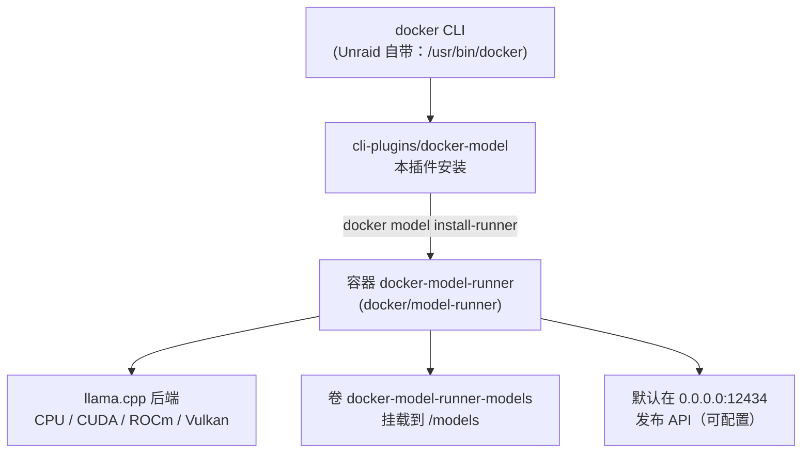
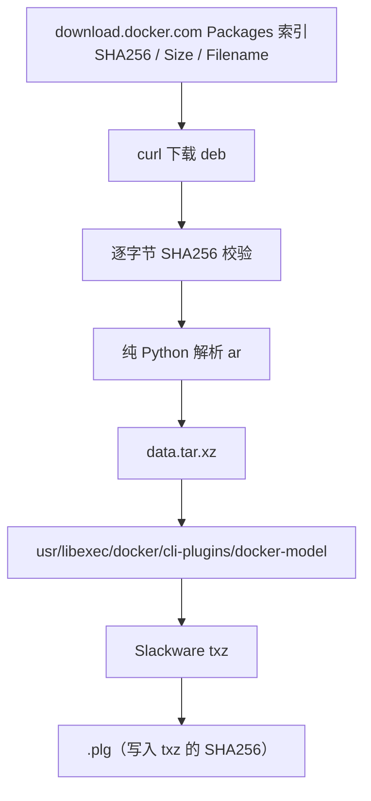

# unraid-plugin-docker-model

[English](README.md) | **简体中文**

[](https://github.com/zhz8888/unraid-plugin-docker-model/actions/workflows/build.yml)
[](LICENSE)

**为 Unraid OS 提供 `docker model`（Docker Model Runner）支持。**

Unraid 官方不带 `docker model` CLI 插件。本项目把它打包成原生 Unraid 插件（`.plg`），
一条 `plugin install` 即可在 Unraid 上本地运行和提供 AI 模型。

---

## 问题背景

`docker model` **不是** Docker Engine 内置命令，而是独立 CLI 插件包
`docker-model-plugin`——`docker-ce-cli` 只是 `Suggests` 它，不是 `Depends`。

Unraid 的 docker 包（`docker-29.x-x86_64-1_LT`，Limetech 重打包为 Slackware txz）
只带两个 CLI 插件：

```
/usr/libexec/docker/cli-plugins/docker-buildx
/usr/lib/docker/cli-plugins/docker-compose
```

没有 `docker-model`。而 Docker 官方只通过发行版包管理器（apt/yum）分发该插件，
**GitHub Releases 上不提供任何二进制**，所以 Unraid 的包格式无法直接消费。

本插件补齐这个缺口。

## 它做了什么



插件把 CLI 二进制装进 `/usr/libexec/docker/cli-plugins/`，并在**每次开机时重新部署**
（Unraid 的 `/usr` 是 overlay，装在那里的东西重启即丢失）。runner 容器本身由
`docker model install-runner` 按需拉取。runner 的 API 默认发布在所有网卡上，
局域网内其它设备可以直接使用；监听地址在页面的「网络」卡片上设置。

## 安装

### 从 Release 安装

```bash
# 在 Unraid 主机上执行
cd /boot/config/plugins
wget -O unraid-plugin-docker-model.plg \
  https://github.com/zhz8888/unraid-plugin-docker-model/releases/latest/download/unraid-plugin-docker-model.plg
plugin install /boot/config/plugins/unraid-plugin-docker-model.plg
```

也可以在 Unraid Web UI 的 **Plugins → Install Plugin** 里填同一个 `.plg` URL。

### 通过 gh-proxy.org 代理安装（中国大陆）

如果你的网络无法直连 GitHub，可以使用**代理版**插件文件。两者唯一的区别是下载
地址——在 GitHub 链接前拼接 `https://gh-proxy.org/` 即可。插件包本身是同一个文件，
逐字节一致，SHA256 也相同。

```bash
# 在 Unraid 主机上执行
cd /boot/config/plugins
wget -O unraid-plugin-docker-model-proxy.plg \
  https://gh-proxy.org/https://github.com/zhz8888/unraid-plugin-docker-model/releases/latest/download/unraid-plugin-docker-model-proxy.plg
plugin install /boot/config/plugins/unraid-plugin-docker-model-proxy.plg
```

同样的前缀适用于任意 GitHub Release 链接，不限于本项目：

```
https://gh-proxy.org/https://github.com/<owner>/<repo>/releases/download/<tag>/<file>
```

两个文件**只需安装其中一个**：Unraid 安装器按 `.plg` 的**文件名**建立软链，两个文件
同时存在会在 Plugins 页显示成两条记录。如果两个都放进了 `/boot/config/plugins/`，
主版会在下次开机时删掉代理版——这与官方 Tailscale 插件清理 preview 分支的做法一致。

验证：

```bash
docker model version
# Client:
#  Version:    v1.2.9
# Server:
#  Version:    v1.2.9
```

### 再部署 runner

```bash
# 仅使用 CPU
docker model install-runner --gpu none

# 使用 NVIDIA / AMD GPU
docker model install-runner --gpu auto
```

不传 `--host` 时，CLI 会把 API 发布到 `127.0.0.1` 和 docker bridge 网关地址上，
所以从终端这样装出来的 runner 只有本机能访问。WebGUI 页面会把保存的监听地址
（默认 `0.0.0.0`）传给 `install-runner`；如果从终端部署并希望局域网能访问，
请自行加上 `--host 0.0.0.0`。

拉取并运行模型：

```bash
docker model pull ai/smollm2:360M-Q4_K_M
docker model run ai/smollm2:360M-Q4_K_M "Hello"
```

`docker model stop-runner` 会移除 runner 容器，但保留 runner 镜像和模型卷，下次
安装直接使用已有镜像、不用重新拉取。捆绑的 CLI 1.2.9 里 `uninstall-runner` 走的是
同一条清理路径，只有它的可选参数才会连镜像和模型卷一起删掉。

### 从 WebGUI 使用

插件会在 Settings 页的 **用户程序（User Utilities）** 区域新增一张
**Docker Model Runner** 卡片，位置与官方 Compose Manager 插件一致。页面是一张
卡片网格，每张卡片负责一件事：

- 顶部横幅：插件图标、一段简短说明、三个实时状态标签（CLI、Runner、Models），
  以及一个 **Refresh** 按钮；
- **Status**：插件版本、捆绑的 docker-model 版本、上游制品，以及
  `docker model version` 的输出——按字段拆成客户端版本、客户端平台、服务端版本、
  服务端引擎四行；原始输出收在可折叠的 **Raw output** 区块里便于排查，CLI 输出的
  格式不认识时自动展开；
- **Model Runner**：runner 的运行状态，以及安装（纯 CPU / GPU 自动探测）、
  **Stop**（停止）和移除按钮。停止只移除容器，runner 镜像和模型卷都会保留；
  每个按钮只在该状态下可用；
- **Network**：runner API 的监听地址、本地客户端 API Key（默认 `local`）、
  容器实际发布的端口、设置文件，以及 **Save** 和 **Recreate runner** 按钮（见下）；
- **Local models**：本地已有模型的表格，每个 tag 一行，显示参数、量化、大小，模型名
  下方第二行是架构与创建日期。每行可以「更新」（重新拉取同一个 tag，未变化的层直接复用）
  或「删除」（确认后从本地模型卷移除），两项操作都在后台执行，日志写入
  `/var/log/docker-model-runner-model.log`；
- **Installation**：CLI 插件目录、CLI 可执行文件、已安装的二进制、等价的
  终端命令（含保存的 `--host` 地址），以及使用已保存 API Key 的 OpenAI 兼容
  Python 客户端示例；
- **Notes**：runner 附带的注意事项。

六张卡片等宽等高：网格会把同一行的卡片拉伸到该行最高的那张，卡片上的按钮因此与
旁边的卡片对齐；模型表格在卡片内部滚动。网格在 780px 以下单列、780px 起两列、
1500px 起三列。

所有需要调用 `docker` 的数据都在页面渲染完成后异步加载，因此 runner 停止时也不会
拖慢页面本身。

页面跟随 Unraid WebGUI 的语言。插件自带翻译文件，放在页面同级的 `locales/` 目录里：
`en_US.json` 是英文基准，`zh_CN.json` 是简体中文。新增语言只需把一份键名相同的
`<locale>.json` 放进该目录即可。

### runner 的网络发布

runner API **默认发布在 `0.0.0.0`**，局域网内任何设备都可以通过
`http://<NAS-IP>:12434` 使用它。这是刻意的：`docker model` 没有 `--network`
参数，只能用 `--host <ip>` 决定容器端口发布到哪个地址；而它自己的默认值
（`127.0.0.1`，再额外绑一个 docker bridge 网关地址）只有本机访问得到。

**Network** 卡片负责选择地址：

| 选项 | 效果 |
|---|---|
| `0.0.0.0`（默认） | 所有网卡，局域网可访问 |
| `127.0.0.1` | 仅本机 |
| 自定义 IPv4 / IPv6 地址 | 指定某一块网卡 |

地址在服务端按 IP 校验后才保存，拼进命令行时再用 `escapeshellarg()` 转义；非法值
会被拒绝、不会保存。它是唯一会进入命令行的设置。监听地址和 API Key 以
`DMR_HOST`、`DMR_API_KEY` 两个键保存在
`/boot/config/plugins/unraid-plugin-docker-model/unraid-plugin-docker-model.cfg`。
文件采用原子写入，权限为仅所有者可读写（`0600`），与缓存的安装包一起放在 flash
上，重启后仍在；和该目录下的其它文件一样，卸载插件后也会保留。旧配置缺少
`DMR_API_KEY` 时默认使用 `local`。

**API Key** 供 OpenAI 兼容客户端使用：这类客户端即使连接本地 runner，也要求传入
`api_key` 占位值。它默认是 `local`，允许 1–128 位字母、数字或 `. _ ~ + / = -`，
可点击「显示」查看。保存空值会恢复为 `local`。「Installation」卡片中的 Python
示例会跟随此字段。该 Key 不会传给 `docker model`，也不会开启鉴权。

地址属于容器定义的一部分，改完设置只在下一个容器上生效：**Recreate runner** 会执行
`docker model reinstall-runner --gpu <探测到的模式> --host <新地址>`，GPU 模式从正在
运行的容器镜像 tag 反查（`-cuda`、`-rocm`、`-musa`、`-cann`，否则为 `none`；
查不到时用 `auto`），避免在 GPU 主机上把纯 CPU 的安装悄悄换成 CUDA。端口不会变，
仍是 `12434`，因为 CLI 连的就是本机的这个端口。

API 依然没有鉴权。`0.0.0.0` 意味着能连到这个网络的任何设备都能用：请用防火墙限制
`12434`，或者把页面改回 `127.0.0.1`。

## 从源码构建

不需要 Go 或 Rust 工具链——本仓库从不编译上游代码。

依赖：Bash 4+、`make`、`curl`、`tar`、`xz`、Python 3。

```bash
git clone https://github.com/zhz8888/unraid-plugin-docker-model.git
cd unraid-plugin-docker-model

make build     # 下载 -> 校验 SHA256 -> 解包 -> 打包 txz -> 生成 plg
make lint      # .plg 检查 + PHP 语法 + 翻译文件
make verify    # 校验哈希与包内结构

ls dist/
# unraid-plugin-docker-model-20261105-x86_64-1.txz   <- Slackware 安装包
# unraid-plugin-docker-model.plg                     <- Unraid 插件定义文件
```

覆盖版本或架构：

```bash
DMR_VERSION=1.2.6               make build   # 换一个上游版本
DMR_ARCH=arm64                  make build   # 换一个架构
PLUGIN_VERSION=20261105         make build   # 固定插件版本号
```

构建是**可复现**的：mtimes 已归一化、打包前清除了 macOS 扩展属性，
因此同一「插件版本 + 上游版本」组合在任何机器、任何检出目录都产出相同的
txz SHA256。CI 会连续构建两次并比对 hash 来强制保证这一点。

### 版本号方案

项目同时跟踪两个互不相关的版本号：

| 版本 | 格式 | 含义 |
|---|---|---|
| 插件版本 | `YYYYMMDD` | 插件自身的发布版本：发布日期。 |
| 上游版本 | `1.2.9` | 捆绑的 `docker-model-plugin` 版本，记录在更新日志、包描述和 WebGUI 页面里。 |

同一天发布多次时，后面的版本追加一个字母后缀：

```
20261105      当天的第一个版本
20261105.a    当天的第二个版本
20261105.b    当天的第三个版本
20261106      第二天
```

Unraid 安装器用 `strcmp()`（按字节比较字符串）比较插件版本，所以格式必须能按
发布顺序递增。这套格式可以（`20261105 < 20261105.a < 20261105.b < 20261106`）；
语义化版本不行：`1.2.10` 排在 `1.2.9` **之后**（字节 `1` < `9`），Unraid 会拒绝
这次升级。

插件版本**刻意不跟随**上游版本：同一个上游版本的重新打包——比如修了安装脚本、
加了 WebGUI 页面——同样要能推给已经装过的用户。

## 二进制来源

本项目**原样**分发 Docker 官方 apt 制品中的 `docker-model` 二进制。



为什么选 apt 制品而不是源码编译？完整评估见
[`docs/01-design-decisions.md`](docs/01-design-decisions.md)。简要结论：

| | apt 制品 | 源码编译 |
|---|---|---|
| 有官方产物可比对 | 有（apt 元数据） | **无**（GitHub Release 无资产） |
| 版本号正确 | `v1.2.9` | 不手动传 `-ldflags` 会退化为 `dev` |
| 构建耗时 | ~2 秒 | ~2 分钟（860MB Go 依赖） |
| 供应链 | apt `InRelease` GPG + `Packages` SHA256 | 394 个 `go.sum` 条目 |
| 可定制 | 否 | 是 |

该二进制为静态链接（`CGO_ENABLED=0`、`-trimpath`），因此 Ubuntu 包在
Slackware 基础的 Unraid 上可直接运行。

## 兼容性

| 项目 | 要求 |
|---|---|
| Unraid | 7.0+（需要 `/usr/libexec/docker/cli-plugins/`） |
| 架构 | x86_64（Unraid 仅支持 x86_64）；`DMR_ARCH=arm64`/`armhf` 可在本地构建对应包，CI 与发布只出 x86_64 |
| Docker | 20.10+（CLI 插件机制） |
| 内存 | 1.5B Q4 模型建议 ≥ 8GB 可用 |
| GPU | 可选，无 GPU 时用 `--gpu none` 纯 CPU 运行 |

## 已知限制

1. **`/usr` 下的任何东西重启即丢失。** Unraid 把 `/usr` 挂成「只读 squashfs + 内存
   overlay」，而 `/var/log`（插件管理器记录「已安装」的地方）是 tmpfs。所以每次开机
   都会重跑插件的安装脚本，从 flash 上缓存的副本恢复二进制。这也是安装脚本必须
   幂等、且**绝不能以非零状态退出**的原因：非零退出会让安装器把 `.plg` 移到
   `/boot/config/plugins-error/`，插件从此没有注册记录，WebGUI 里连卸载按钮都没有。
2. **`/root/.docker` 是 `/boot/config/plugins/dockerMan` 的软链（vfat）。**
   放 `~/.docker/cli-plugins/` 的插件会丢失执行位并遮蔽系统目录，报 `permission denied`。
   只能用 `/usr/libexec/docker/cli-plugins/`。安装脚本还会清掉 Docker CLI 其余搜索
   目录里的同名副本——因为**先命中的那个生效**。
3. **`docker model pull` 不读 `daemon.json` 的 `registry-mirrors`。**
   runner 直连 registry。受限网络请用带代理前缀的全名，例如
   `docker model pull gh-proxy.org/docker/ai/smollm2:360M-Q4_K_M`。
4. **runner API 无鉴权。** 页面默认把它发布到 `0.0.0.0`，局域网内所有设备都能
   访问。不需要时在页面上改成 `127.0.0.1`，或用防火墙限制 `12434` 端口；不要暴露
   到不可信网络。

## 与 Unraid 官方插件规范的对照

本插件遵循 Lime Technology 官方维护的插件（`unraid/unraid-tailscale`、
`unraid/apprise-plugin`、`unraid/unraid-nvidia-driver`）的惯例：

- 日期式插件版本号——因为安装器用 `strcmp()` 比较插件版本；
- 用 Slackware 包安装（`upgradepkg`）、用 `removepkg` 卸载；
- WebGUI 页面放在 `/usr/local/emhttp/plugins/<name>/`，`launch` 与 `icon`
  属性指向它；
- 每个下载文件都带 `<SHA256>`，缓存文件名里含版本号；
- 安装脚本幂等，且永不以非零状态退出。

[`docs/05-unraid-plugin-conventions.md`](docs/05-unraid-plugin-conventions.md)
逐条给出规范与实现的对应关系，并列出仍需在真实 Unraid 主机上验证的点。

## 命名约定

| 位置 | 名称 | 说明 |
|---|---|---|
| 仓库 | `unraid-plugin-docker-model` | 本项目 |
| Unraid 插件 | `unraid-plugin-docker-model` | `<PLUGIN name="...">` |
| `.plg` 文件 | `unraid-plugin-docker-model.plg` | 放 `/boot/config/plugins/` |
| 代理版 `.plg` | `unraid-plugin-docker-model-proxy.plg` | 与主版**二选一**安装 |
| flash 缓存目录 | `/boot/config/plugins/unraid-plugin-docker-model/` | 存放 txz 和设置文件 `unraid-plugin-docker-model.cfg` |
| Slackware 包 | `unraid-plugin-docker-model-<插件版本>-x86_64-1.txz` | 由 `upgradepkg` 安装 |
| 安装的二进制 | `/usr/libexec/docker/cli-plugins/docker-model` | **名字固定** |
| WebGUI 页面 | `/usr/local/emhttp/plugins/unraid-plugin-docker-model/DockerModelRunner.page` | `launch` 属性指向它，以卡片形式显示在 `Settings → 用户程序` 下 |
| runner 容器 | `docker-model-runner` | 由 `install-runner` 创建 |

安装的二进制**必须**叫 `docker-model`：docker CLI 靠 `docker-<子命令>` 的
文件名约定发现插件。其余全部使用 `unraid-plugin-docker-model` 前缀。

## 仓库结构

```
.
├── README.md                              # 英文版 README
├── README.zh-CN.md                        # 本文件
├── CHANGELOG.md
├── CONTRIBUTING.md
├── SECURITY.md
├── LICENSE                                # MIT（本项目自身）
├── NOTICE                                 # 捆绑二进制的 Apache-2.0 归属声明
├── icon.svg                               # 插件图标设计源，打包用的 PNG 由它渲染
├── ca_profile.xml                         # CA 仓库信息
├── Makefile                               # build / lint / verify 快捷命令
├── ca/
│   └── unraid-plugin-docker-model.xml     # CA 收录条目
├── docs/
│   ├── README.md                          # 文档索引
│   ├── 01-design-decisions.md             # apt 制品与源码编译选型对比
│   ├── 02-technical-design.md             # 架构与安装/卸载流程
│   ├── 03-verification-log.md             # 实测证据
│   ├── 04-roadmap.md                      # 里程碑与待办
│   └── 05-unraid-plugin-conventions.md    # 与 Unraid 官方插件规范的逐条对照
├── plugin/
│   └── unraid-plugin-docker-model.plg.in  # Unraid 插件模板
├── src/                                   # Slackware 包源码树
│   ├── install/
│   │   ├── slack-desc                     # 包描述
│   │   └── doinst.sh                      # 安装后钩子
│   └── usr/local/emhttp/plugins/unraid-plugin-docker-model/
│       ├── DockerModelRunner.page         # WebGUI 页面（Settings → 用户程序 卡片）
│       ├── README.md                      # Plugins 页的插件说明
│       ├── diagnostics.json               # 支持包定义
│       ├── unraid-plugin-docker-model.png # 图标
│       ├── locales/
│       │   ├── en_US.json                 # 英文基准翻译
│       │   └── zh_CN.json                 # 简体中文翻译
│       ├── sheets/
│       │   └── DockerModelRunner.css      # 卡片布局，Unraid 自动引入
│       └── include/
│           ├── common.php                 # 公共辅助函数
│           ├── Pages/Home.php             # 卡片网格
│           └── data/{Status,Action}.php   # AJAX 数据与操作接口
├── scripts/
│   ├── build-plugin.sh                    # 构建：deb -> 校验 -> 解包 -> txz -> plg
│   ├── check-locales.py                   # 校验翻译文件
│   ├── check-php-syntax.py                # 校验 WebGUI 源码
│   ├── fetch-plugin.sh                    # 仅下载 + 校验 + 解包（审计用）
│   ├── lint-plg.sh                        # 对 .plg 做静态检查
│   ├── make-icon.py                       # 由 icon.svg 渲染插件图标
│   └── verify-release.sh                  # 校验哈希与包内结构
└── .github/
    ├── workflows/build.yml                # CI：构建、lint、verify、可复现性校验
    ├── workflows/upstream-check.yml       # 每日检查上游新版本
    └── ISSUE_TEMPLATE/
```

## 文档

深入文档在 [`docs/`](docs/README.md)，为中文撰写；代码、脚本与本 README 为英文。

- [选型评估](docs/01-design-decisions.md) — 为什么用 apt 制品而不是源码编译
- [技术方案](docs/02-technical-design.md) — 插件机制、安装/卸载流程、镜像前缀处理
- [验证记录](docs/03-verification-log.md) — 真实 Unraid 主机上的实测数据
- [开发计划](docs/04-roadmap.md) — 里程碑与待决问题
- [官方插件规范对照](docs/05-unraid-plugin-conventions.md) — 本插件与 Unraid 官方规范的逐条映射

## 贡献

见 [CONTRIBUTING.md](CONTRIBUTING.md)。提交 PR 前请跑：

```bash
make build && make lint && make verify
```

`docker model` 本身的问题请报到上游
[docker/model-runner](https://github.com/docker/model-runner/issues)——
本仓库只负责把它打包给 Unraid。

## 许可

- 本项目的脚本与文档：**MIT**，见 [LICENSE](LICENSE)
- 捆绑的 `docker-model` 二进制：**Apache-2.0**，© Docker, Inc.，原样分发，见 [NOTICE](NOTICE)

`docker/model-runner` 容器镜像不由本项目分发，由用户运行时自行拉取。
