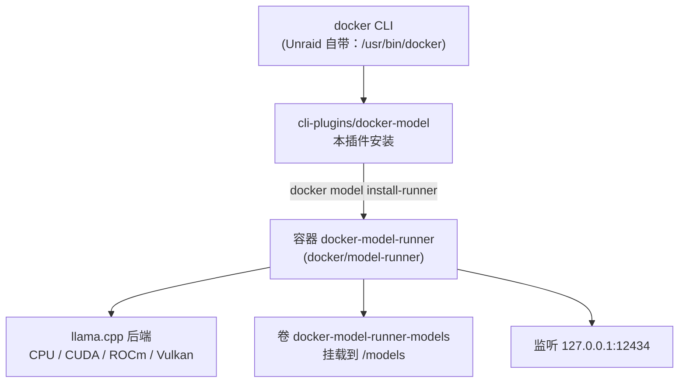
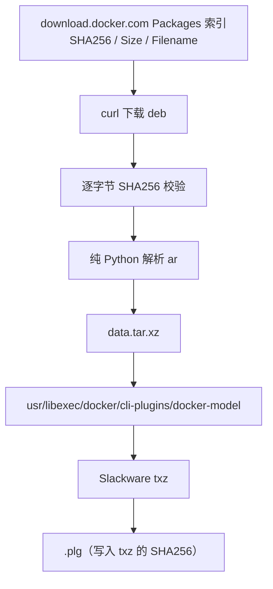

# unraid-plugin-docker-model

[](https://github.com/zhz8888/unraid-plugin-docker-model/actions/workflows/build.yml)
[](LICENSE)

**为 Unraid OS 提供 `docker model`（Docker Model Runner）支持。**

Unraid 官方不带 `docker model` CLI 插件。本项目把它打包成原生 Unraid 插件（`.plg`），
一条 `plugin install` 即可在 Unraid 上本地运行和提供 AI 模型。

> [English README](README.md)

---

## 问题背景

`docker model` **不是** Docker Engine 内置命令，而是独立 CLI 插件包
`docker-model-plugin`——`docker-ce-cli` 只是 `Suggests` 它，不是 `Depends`。

Unraid 的 docker 包（`docker-29.x-x86_64-1_LT`，Limetech 重打包为 Slackware txz）
只带两个 CLI 插件：

```
/usr/libexec/docker/cli-plugins/docker-buildx
/usr/lib/docker/cli-plugins/docker-compose
```

没有 `docker-model`。而 Docker 官方只通过发行版包管理器（apt/yum）分发该插件，
**GitHub Releases 上不提供任何二进制**，所以 Unraid 的包格式无法直接消费。

本插件补齐这个缺口。

## 它做了什么



插件把 CLI 二进制装进 `/usr/libexec/docker/cli-plugins/`，并在**每次开机时重新部署**
（Unraid 的 `/usr` 是 overlay，装在那里的东西重启即丢失）。runner 容器本身由
`docker model install-runner` 按需拉取。

## 安装

### 从 Release 安装

```bash
# 在 Unraid 主机上执行
cd /boot/config/plugins
wget -O unraid-plugin-docker-model.plg \
  https://github.com/zhz8888/unraid-plugin-docker-model/releases/latest/download/unraid-plugin-docker-model.plg
plugin install /boot/config/plugins/unraid-plugin-docker-model.plg
```

也可以在 Unraid Web UI 的 **Plugins → Install Plugin** 里填同一个 `.plg` URL。

验证：

```bash
docker model version
# Client:
#  Version:    v1.2.9
# Server:
#  Version:    v1.2.9
```

### 再部署 runner

```bash
# 仅使用 CPU
docker model install-runner --gpu none

# 使用 NVIDIA / AMD GPU
docker model install-runner --gpu auto
```

拉取并运行模型：

```bash
docker model pull ai/smollm2:360M-Q4_K_M
docker model run ai/smollm2:360M-Q4_K_M "Hello"
```

## 从源码构建

不需要 Go 或 Rust 工具链——本仓库从不编译上游代码。

依赖：Bash 4+、`curl`、`tar`、`xz`、Python 3。

```bash
git clone https://github.com/zhz8888/unraid-plugin-docker-model.git
cd unraid-plugin-docker-model

make build     # 下载 -> 校验 SHA256 -> 解包 -> 打包 txz -> 生成 plg
make lint      # 对生成的 .plg 做静态检查
make verify    # 校验哈希与包内结构

ls dist/
# unraid-plugin-docker-model-1.2.9-x86_64-1.txz   <- Slackware 安装包
# unraid-plugin-docker-model.plg                  <- Unraid 插件定义文件
```

覆盖版本或架构：

```bash
DMR_VERSION=1.2.6 make build
DMR_ARCH=arm64    make build
```

构建是**可复现**的：mtimes 已归一化、打包前清除了 macOS 扩展属性，
因此同一上游版本在任何机器、任何检出目录都产出相同的 txz SHA256。
CI 会连续构建两次并比对 hash 来强制保证这一点。

## 二进制来源

本项目**原样**分发 Docker 官方 apt 制品中的 `docker-model` 二进制。



为什么选 apt 制品而不是源码编译？完整评估见
[`docs/01-design-decisions.md`](docs/01-design-decisions.md)。简要结论：

| | apt 制品 | 源码编译 |
|---|---|---|
| 有官方产物可比对 | 有（apt 元数据） | **无**（GitHub Release 无资产） |
| 版本号正确 | `v1.2.9` | 不手动传 `-ldflags` 会退化为 `dev` |
| 构建耗时 | ~2 秒 | ~2 分钟（860MB Go 依赖） |
| 供应链 | apt `InRelease` GPG + `Packages` SHA256 | 394 个 `go.sum` 条目 |
| 可定制 | 否 | 是 |

该二进制为静态链接（`CGO_ENABLED=0`、`-trimpath`），因此 Ubuntu 包在
Slackware 基础的 Unraid 上可直接运行。

## 兼容性

| 项目 | 要求 |
|---|---|
| Unraid | 7.0+（需要 `/usr/libexec/docker/cli-plugins/`） |
| 架构 | x86_64（Unraid 仅支持 x86_64；也构建 arm64/armhf 包） |
| Docker | 20.10+（CLI 插件机制） |
| 内存 | 1.5B Q4 模型建议 ≥ 8GB 可用 |
| GPU | 可选，无 GPU 时用 `--gpu none` 纯 CPU 运行 |

## 已知限制

1. **`/usr` 下的任何东西重启即丢失。** `.plg` 会在开机时重跑 `upgradepkg` 恢复二进制。
2. **`/root/.docker` 是 `/boot/config/plugins/dockerMan` 的软链（vfat）。**
   放 `~/.docker/cli-plugins/` 的插件会丢失执行位并遮蔽系统目录，报 `permission denied`。
   只能用 `/usr/libexec/docker/cli-plugins/`。
3. **`docker model pull` 不读 `daemon.json` 的 `registry-mirrors`。**
   runner 直连 registry。受限网络请用带代理前缀的全名，例如
   `docker model pull gh-proxy.org/docker/ai/smollm2:360M-Q4_K_M`。
4. **runner API 无鉴权。** 默认只绑 `127.0.0.1` 和 docker bridge 网关，
   不要把 `12434` 端口暴露到不可信网络。

## 命名约定

| 位置 | 名称 | 说明 |
|---|---|---|
| 仓库 | `unraid-plugin-docker-model` | 本项目 |
| Unraid 插件 | `unraid-plugin-docker-model` | `<PLUGIN name="...">` |
| `.plg` 文件 | `unraid-plugin-docker-model.plg` | 放 `/boot/config/plugins/` |
| flash 缓存目录 | `/boot/config/plugins/unraid-plugin-docker-model/` | 存放 txz |
| Slackware 包 | `unraid-plugin-docker-model-<ver>-x86_64-1.txz` | 由 `upgradepkg` 安装 |
| 安装的二进制 | `/usr/libexec/docker/cli-plugins/docker-model` | **名字固定** |
| runner 容器 | `docker-model-runner` | 由 `install-runner` 创建 |

安装的二进制**必须**叫 `docker-model`：docker CLI 靠 `docker-<子命令>` 的
文件名约定发现插件。其余全部使用 `unraid-plugin-docker-model` 前缀。

## 仓库结构

```
.
├── README.md                              # 英文版 README
├── README.zh-CN.md                        # 本文件
├── CHANGELOG.md
├── CONTRIBUTING.md
├── SECURITY.md
├── LICENSE                                # MIT（本项目自身）
├── NOTICE                                 # 捆绑二进制的 Apache-2.0 归属声明
├── Makefile                               # build / lint / verify 快捷命令
├── docs/
│   ├── README.md                          # 文档索引
│   ├── 01-design-decisions.md             # apt 制品与源码编译选型对比
│   ├── 02-technical-design.md             # 架构与安装/卸载流程
│   ├── 03-verification-log.md             # 实测证据
│   └── 04-roadmap.md                      # 里程碑与待办
├── plugin/
│   └── unraid-plugin-docker-model.plg.in  # Unraid 插件模板
├── scripts/
│   ├── build-plugin.sh                    # 构建：deb -> 校验 -> 解包 -> txz -> plg
│   ├── fetch-plugin.sh                    # 仅下载 + 校验 + 解包（审计用）
│   ├── lint-plg.sh                        # 对 .plg 做静态检查
│   └── verify-release.sh                  # 校验哈希与包内结构
└── .github/
    ├── workflows/build.yml                # CI：构建、lint、verify、可复现性校验
    ├── workflows/upstream-check.yml       # 每日检查上游新版本
    └── ISSUE_TEMPLATE/
```

## 文档

深入文档在 [`docs/`](docs/README.md)，为中文撰写；代码、脚本与本 README 为英文。

- [选型评估](docs/01-design-decisions.md) — 为什么用 apt 制品而不是源码编译
- [技术方案](docs/02-technical-design.md) — 插件机制、安装/卸载流程、镜像前缀处理
- [验证记录](docs/03-verification-log.md) — 真实 Unraid 主机上的实测数据
- [开发计划](docs/04-roadmap.md) — 里程碑与待决问题

## 贡献

见 [CONTRIBUTING.md](CONTRIBUTING.md)。提交 PR 前请跑：

```bash
make build && make lint && make verify
```

`docker model` 本身的问题请报到上游
[docker/model-runner](https://github.com/docker/model-runner/issues)——
本仓库只负责把它打包给 Unraid。

## 许可

- 本项目的脚本与文档：**MIT**，见 [LICENSE](LICENSE)
- 捆绑的 `docker-model` 二进制：**Apache-2.0**，© Docker, Inc.，原样分发，见 [NOTICE](NOTICE)

`docker/model-runner` 容器镜像不由本项目分发，由用户运行时自行拉取。
