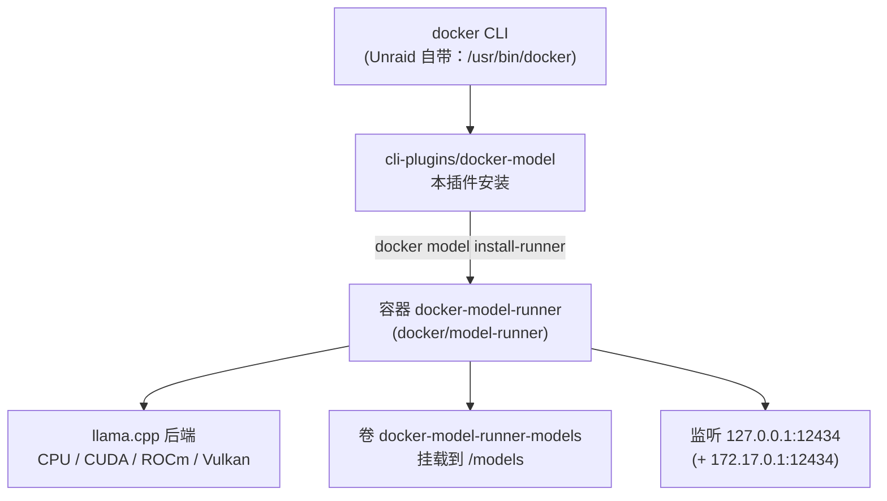
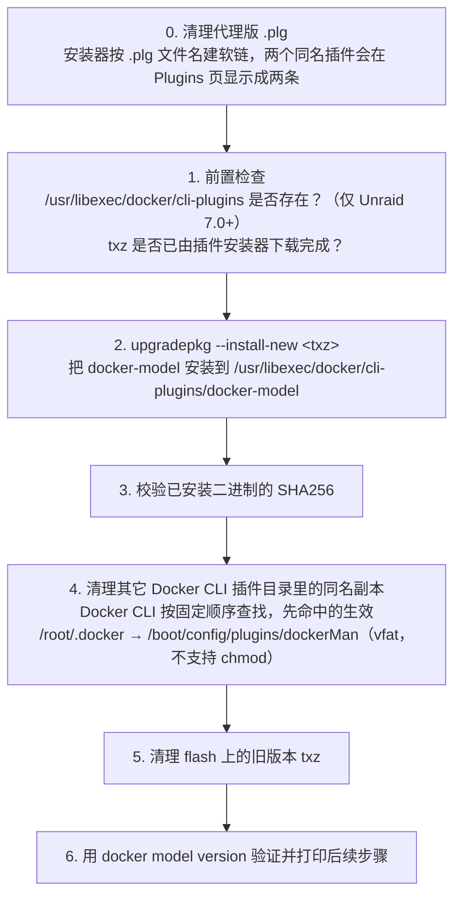
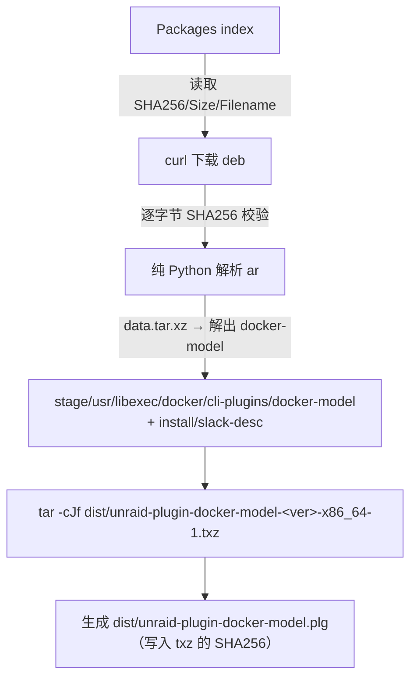

# 技术设计

## 一、Unraid 插件机制速查

| 机制 | 说明 |
|---|---|
| 插件定义 | `*.plg`（XML），放在 `/boot/config/plugins/` |
| 开机执行 | `/etc/rc.d/rc.local` 遍历 `/boot/config/plugins/*.plg`，逐个 `plugin install` |
| 安装器 | `/usr/local/sbin/plugin`（PHP，源码见 `unraid/webgui` → `emhttp/plugins/dynamix.plugin.manager/scripts/plugin`），下载 `<FILE>` → 校验 `<SHA256>` → 执行 `<FILE Run>` |
| 已装标记 | 成功后建软链 `/var/log/plugins/<plg 文件名>.plg → /boot/config/plugins/<plg 文件名>.plg`（按**文件名**建，不是按 `name` 属性） |
| 文件缓存 | `<FILE Name="/boot/config/plugins/<name>/xxx">` 下载后缓存在 flash 上，**已存在的文件不会被覆盖**，所以缓存文件名必须带版本号 |
| 版本比较 | 插件版本之间用 `strcmp()`（按字节比较字符串），不是语义化比较；`min`/`max` 与 Unraid 版本之间才用 `version_compare()` |
| 包管理 | Slackware 原生：`installpkg` / `upgradepkg --install-new` / `removepkg` / `makepkg` |
| 卸载 | `<FILE Run="..." Method="remove">` |

> **两次重启语义**：`/var/log` 是 tmpfs（`rc.S` 里 `mount -t tmpfs … /var/log`），
> `/usr` 是只读 squashfs + 内存 overlay。两者都不跨重启，所以**每次开机都是全新安装**，
> 安装脚本每次都会执行。这也是安装脚本必须幂等、且**绝不能以非零状态退出**的原因：
> 非零退出会让安装器把 `.plg` 移到 `/boot/config/plugins-error/`，并且不建
> `/var/log/plugins` 软链——插件在 WebGUI 里既不显示、也没有卸载按钮。
>
> 参考实现：`unraid/unraid-tailscale` 的 `plugin/tailscale.plg`（结构最标准）。

### 两个 `.plg`：直连版与代理版

构建产物有两个插件文件，来自同一个模板 `plugin/unraid-plugin-docker-model.plg.in`：

| 文件 | 下载来源 |
|---|---|
| `unraid-plugin-docker-model.plg` | GitHub Release 资产，直连 |
| `unraid-plugin-docker-model-proxy.plg` | 同一资产，经 `https://gh-proxy.org/` 代理 |

两者**只有三处不同**：`pluginURL` 属性、`<URL>` 下载地址、`<CHANGES>` 里的一句来源说明。
插件名、`<FILE Name>` 缓存路径、安装/卸载脚本、SHA256 全部相同，因此装出来的是同一个包。

代理规则就是把 GitHub 链接整体拼到代理前缀后面：

```
https://gh-proxy.org/https://github.com/<owner>/<repo>/releases/download/<tag>/<file>
```

代理返回的是原始字节，所以 SHA256 不变，`verify-release.sh` 对代理版的校验结果与直连版一致。

> 两个文件**只需安装其中一个**。插件名相同，同时放在 `/boot/config/plugins/` 不会冲突，
> 但会让 `/etc/rc.d/rc.local` 在每次开机时把同一个包装两遍。

## 二、为什么是「CLI 插件 + 容器」两层



**关键点：CLI 插件和 runner 容器是两个独立的东西。**

- 插件（28MB 静态二进制）只负责把 `docker model` 这个子命令加进 docker CLI
- runner（969MB 镜像）才是真正跑推理的容器，由 `docker model install-runner` 拉起

本插件**只分发 CLI 插件**，runner 镜像让用户按需拉取。理由：

1. 969MB 镜像塞进 flash（FAT32）不现实，且 Unraid flash 只有 32GB 上限
2. runner 镜像有 `cpu` / `cuda` / `rocm` / `vllm-cuda` 多个变体，取决于用户硬件
3. 镜像走 `docker pull` 天然支持 registry mirror，插件走文件分发不支持

## 三、安装流程（`.plg` 的 `<FILE Run>`）



**幂等性**：`upgradepkg --install-new` 对已装同版本是 no-op，`rm -f` 对不存在文件是 no-op，
因此开机反复执行安全。

**永远 `exit 0`**：任何失败分支都只打印错误，不让脚本以非零状态退出。原因见第一节：
非零退出会中止安装、把 `.plg` 移进 `plugins-error/`，插件从此在 WebGUI 里不可见、
不可卸载。插件保持「已注册」状态，用户才能自己卸载或更新。

## 四、卸载流程

```
1. 如果 runner 仍在运行，提示用户手动执行 uninstall-runner
   （绝不自动删除，避免误删模型）
2. removepkg unraid-plugin-docker-model
3. 清理残留（/usr/libexec/... 、~/.docker/... 、flash 上缓存的 txz）
```

## 五、构建流程（`scripts/build-plugin.sh`）



### 为什么必须自己解析 ar

测试机实测：

```
$ which ar dpkg dpkg-deb
which: no ar in (...)
which: no dpkg in (...)
which: no dpkg-deb in (...)
```

Unraid base OS 只有 `tar` / `xz` / `python3`（且 python3 来自 NerdTools，非 base）。
所以脚本用 **Python 优先 + 纯 shell 兜底**：

- Python 路径：按 ar 头固定布局（name[16] + ... + size[10]）逐块切分
- shell 路径：用 `dd` + `wc -c` 做同样的偏移计算

> 注意：构建脚本跑在**开发机**上（macOS/Linux 都行），不是跑在 Unraid 上。
> Unraid 上只需要能 `upgradepkg`，不需要 `ar`。

## 六、镜像拉取：`gh-proxy.org/docker/` 前缀

**实测结论：`docker model pull` 完全不读 `daemon.json` 的 `registry-mirrors`。**

runner 容器内部用 containerd 的 resolver 直连 `registry-1.docker.io`，测试机上表现为：

```
failed to do request: Head "https://registry-1.docker.io/v2/ai/smollm2/manifests/...":
  dial tcp 192.133.77.191:443: connect: connection refused
```

绕过方式：**把代理前缀写进镜像名本身**。

```bash
# 模型
docker model pull gh-proxy.org/docker/ai/smollm2:360M-Q4_K_M

# runner 镜像（install-runner 之前需要手动拉取并打标签）
docker pull gh-proxy.org/docker/docker/model-runner:latest
docker tag  gh-proxy.org/docker/docker/model-runner:latest docker/model-runner:latest
docker model install-runner --gpu none
```

已验证 `gh-proxy.org/docker/` 对以下路径均可用：

| 路径 | 结果 |
|---|---|
| `gh-proxy.org/docker/nginx:latest` | ✅ |
| `gh-proxy.org/docker/library/nginx:latest` | ✅ |
| `gh-proxy.org/docker/grafana/grafana:latest` | ✅ |
| `gh-proxy.org/docker/docker/model-runner:latest` | ✅ |
| `gh-proxy.org/docker/ai/smollm2:latest` | ✅ |
| `gh-proxy.org/docker/model-runner:latest`（缺一级） | ❌ 401 denied |

> 规律：**`gh-proxy.org/docker/<registry 路径>`**，即 Docker Hub 上的完整 repo 名。
> `nginx` 这种官方镜像需要 `library/nginx` 或直接 `nginx`（代理会补 `library/`）。

## 七、许可与合规

| 组件 | 许可 | 说明 |
|---|---|---|
| `docker-model` CLI | Apache-2.0 | 来自 Docker Inc.，本插件原样分发二进制，保留 upstream 声明 |
| `docker/model-runner` 镜像 | Apache-2.0 | 由用户自行 `docker pull`，不在本项目分发 |
| llama.cpp（镜像内） | MIT | 由 runner 镜像自带 |
| 本项目脚本/文档 | MIT | |

**分发说明**：`.plg` 的 `CHANGES` 里注明二进制来源与版本，`docs/01-design-decisions.md` 记录校验链，
符合 Apache-2.0 的 NOTICE 要求（上游仓库根目录已有 LICENSE）。

## 八、版本锁定策略

| 锁定项 | 值 | 原因 |
|---|---|---|
| 插件版本 | `YYYY.MM.DD.HHMM`（如 `2026.11.05.2050`） | Unraid 用 `strcmp()` 比较插件版本，固定宽度的日期能保证字典序与时间序一致；语义化版本会出事（`1.2.10 < 1.2.9`） |
| CLI 插件版本 | `1.2.9` | 与 runner 镜像同源 tag，避免协议不匹配；作为 `upstream` 单独记录 |
| runner 镜像 tag | `latest`（默认）或 `v1.2.9` | `install-runner` 默认拉 `latest`；如需固定可 `MODEL_RUNNER_CONTROLLER_VERSION=v1.2.9` |
| 最低 Unraid | `7.0.0` | 7.0 起才有 `/usr/libexec/docker/cli-plugins` |

**插件版本与上游版本解耦**：插件版本描述的是「这个插件包」，上游版本描述的是
「里面那个二进制」。同一个上游版本的重新打包（修安装脚本、加 WebGUI 页面）
同样要能推给已安装的用户，所以两者不能绑死。

**升级 CLI 与镜像要同步**：CLI 1.2.9 对 runner 1.0.0 是兼容的（实测通过），
但跨大版本（如 CLI 1.0 → 1.2）建议一起升。
